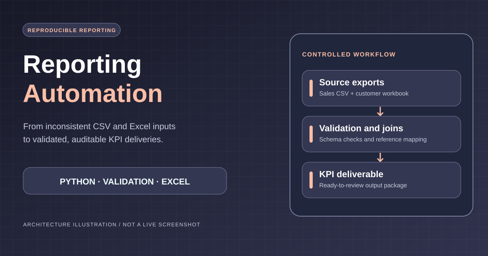

# Excel/CSV Reporting Automation — Paid Pilot Demo

**Reviewer quick brief:** [Project scope, inspectable evidence and limitations](docs/hiring-summary.md).



> This diagram illustrates the data workflow. The paid-pilot sample datasets and entities are **synthetic**, not client data.


**One small, auditable, white-label deliverable for BI and software agencies.**

A Python workflow takes inconsistent order exports (`sales.csv`) plus a customer reference workbook (`customers.xlsx`), validates business-critical data, joins records and exports a ready-to-review KPI pack. **All data and customer names in this repository are synthetic.**

[](https://github.com/senanurcetin/excel-csv-reporting-automation/actions/workflows/ci.yml)

**[Live KPI Dashboard](https://excel-csv-reporting-automation.vercel.app/)** · **[GitHub Actions CI](https://github.com/senanurcetin/excel-csv-reporting-automation/actions/workflows/ci.yml)**

The hosted page is a static dashboard built from synthetic sample data. To process new Excel/CSV files, run the Python workflow locally or in an authorized environment.
## What the client receives

| Artifact | Purpose |
|---|---|
| `outputs/cleaned_sales.csv` | Standardized records with customer dimensions and auditable revenue values |
| `outputs/quality_issues.csv` | Quarantined rows with exact issue codes and source row numbers |
| `outputs/category_kpis.csv` | Recognized revenue and orders by category |
| `outputs/monthly_kpis.csv` | Recognized revenue and orders by month |
| `outputs/segment_kpis.csv` | Recognized revenue and orders by customer segment |
| `outputs/validation_summary.json` | Machine-readable QA counts, totals, business rules and reconciliation |
| `outputs/dashboard.html` | Standalone, print-friendly visual KPI report (no server required) |
| `tests/` | Repeatable quality tests using pytest |

## Quick start

```bash
python -m venv .venv
source .venv/bin/activate  # Windows PowerShell: .venv\Scripts\Activate.ps1
pip install -r requirements.txt
python run_demo.py
python -m pytest -q
```

Open `outputs/dashboard.html` in a browser. No API keys, cloud account, personal data or network connection required after dependency installation. Python 3.10+ recommended.

Custom paths:

```bash
python run_demo.py --sales inputs/sales.csv --customers inputs/customers.xlsx --output outputs
```

### Input contract

- **Sales CSV:** `order_id,order_date,customer_id,category,quantity,unit_price_usd,status`
- **Customer XLSX (first worksheet):** `customer_id,customer_name,segment,region`
- Dates must be `YYYY-MM-DD`; unit prices use USD with at most two decimals; quantities are positive whole numbers.
- Accepted statuses: `paid`, `completed`, `refunded`, `cancelled` (case-insensitive). Identity codes and free-text fields are trimmed; identity codes are case-insensitive.

### Explicit, testable business rules

1. Only `paid` and `completed` orders contribute to recognized revenue. Fully `refunded` and `cancelled` order values are reported separately, not deducted twice. This is a **demo business rule**, not a universal accounting standard.
2. Rows with missing/unknown customer IDs, invalid dates, nonpositive/noninteger quantities, negative/overprecise unit prices, missing categories or invalid statuses go to `quality_issues.csv`.
3. Identical repeated order IDs retain the first occurrence and quarantine later copies. **Conflicting repeated IDs quarantine all affected records**; the pipeline never picks an arbitrary winner.
4. A duplicated/malformed customer reference ID aborts processing with a clear error rather than creating a many-to-many join.
5. `source_rows = valid_rows + excluded_rows` is checked and shown in the KPI report. Some excluded rows may have multiple issue codes.
6. Report outputs are reproducible: the same inputs produce byte-identical CSV files. The HTML dashboard is standalone and has no external tracking scripts.

> **Commercial scope:** For a real pilot, an anonymized input sample, target report layout, KPI definitions, acceptance checks and expected delivery date must be reviewed *before* confirming price or turnaround. This demo does not include client systems integration, access to production databases or bespoke model training.

## Sample result (included synthetic data)

The bundled sample contains **200 source rows**, of which **192 are valid and 8 are excluded**. With the clearly specified demonstration revenue policy, recognized revenue is **$56,975.50 USD**. Outputs are recalculated from input files on every run; the values are *not* hard-coded in the pipeline. All records are fictional.

See [`PILOT_SCOPE.md`](PILOT_SCOPE.md) for a client-facing fixed-scope handoff and acceptance checklist.

**Reproducible handoff:** [Input/output contracts, synthetic reconciliation and acceptance evidence](docs/PILOT_HANDOFF.md).

**Release readiness:** [Candidate notes and acceptance checks](docs/RELEASE_NOTES_CANDIDATE.md) — these are not an already published GitHub Release.

**Checked-in output verification:** `python scripts/verify_release_evidence.py` independently checks synthetic row counts, revenue totals, status treatment and group aggregates using only Python's standard library.

## Project layout

```text
agency_data_automation_demo/
├── inputs/
│   ├── sales.csv                # synthetic transactions with intentional defects
│   └── customers.xlsx           # synthetic lookup table
├── outputs/                    # generated sample deliverables
├── tests/test_pipeline.py      # QA and business-rule tests
├── processor.py                # validation, transformations and KPI aggregation
├── reporting.py                # offline HTML KPI report
├── run_demo.py                 # command-line entry point
├── requirements.txt
└── README.md
```

## Pilot handoff example

The demo represents a *small, fixed-scope* package: two agreed source formats, one report-ready joined table, KPI outputs, issue log, Python source, QA checks and a short handover. Pricing is defined after a sanitized sample and confirmation of expected volume, matching keys and calculation rules. White-label handover and confidentiality terms are agreed separately.

**Contact:** [senanur.cetin.work@gmail.com](mailto:senanur.cetin.work@gmail.com) · **GitHub:** https://github.com/senanurcetin · **Portfolio:** https://senanur-cetin.vercel.app/